# Pull request 14860: the whole flow at 1280 x 720

Pictures for [tangency-labs/solidcraft#14860](https://github.com/tangency-labs/solidcraft/pull/14860), "a link can keep a linked design's components as a linked subassembly, each occurrence rigid or flexible".

The example is a real assembly from my own work: a vacuum chamber of 211 bodies with a latch assembly linked into it. Every picture is the whole app window at 1280 x 720, uncropped (captured on a 150% display and scaled to 1280 x 720). The strip under each picture and the magenta marks are mine. The same pictures without marks are in [`plain/`](plain).

The pictures are from the pull request's branch at `39bebde94`.

## 1. The assembly and the ribbon

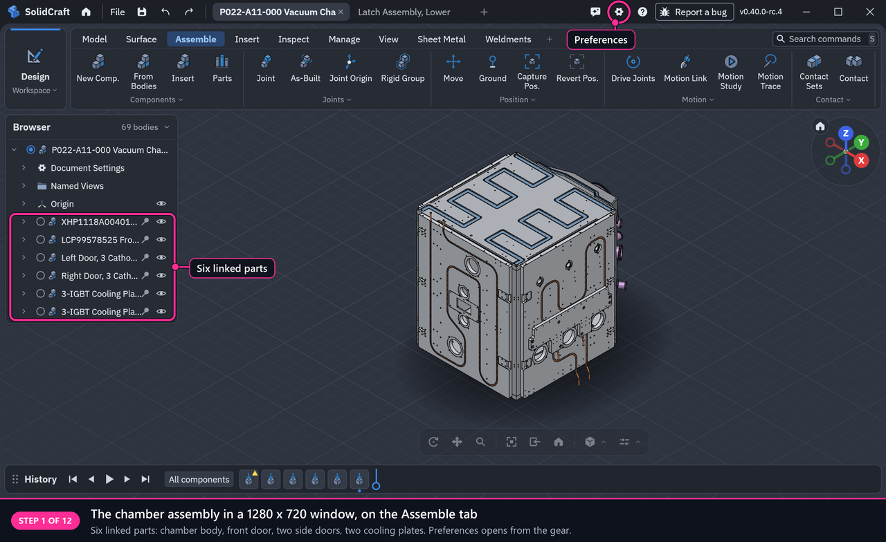

## 2. The two preferences, as shipped

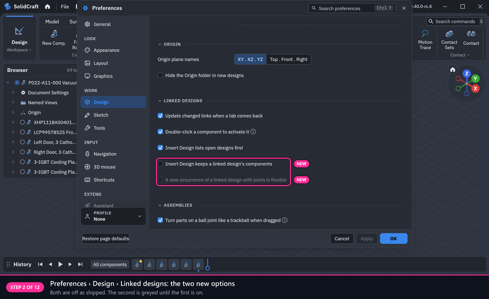

## 3. Turning the option on

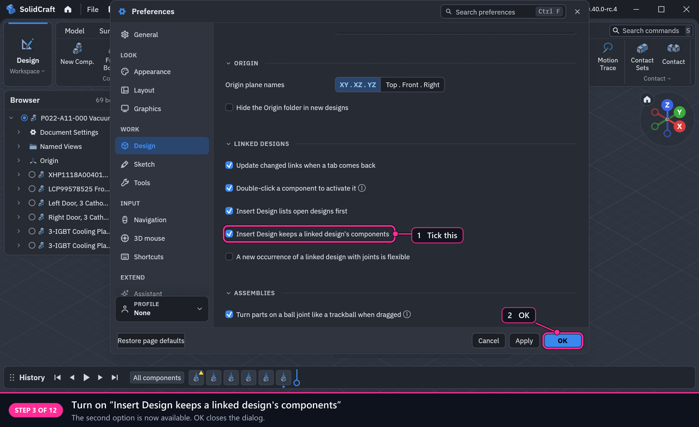

## 4. Insert Design

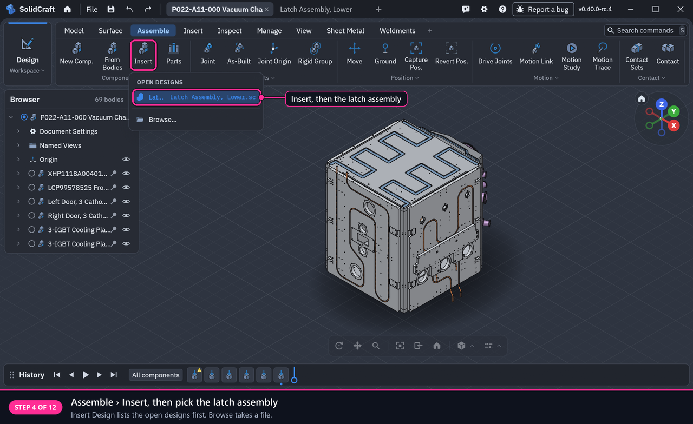

## 5. The Browser: a linked subassembly

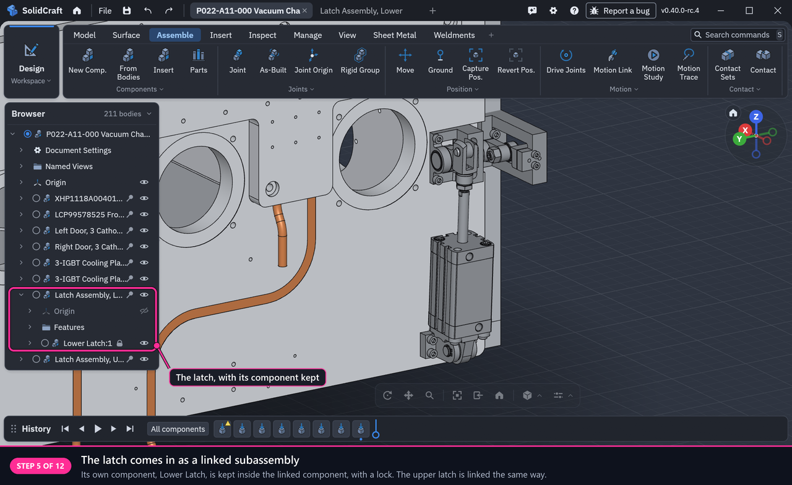

## 6. The Browser: its parts, locked

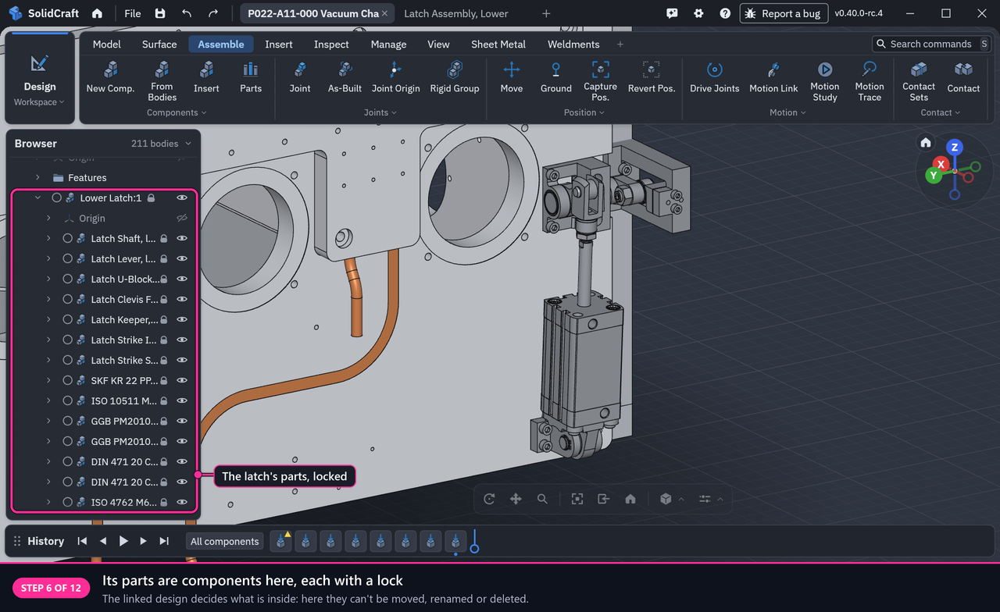

## 7. Keep Its Components, for a link that keeps none

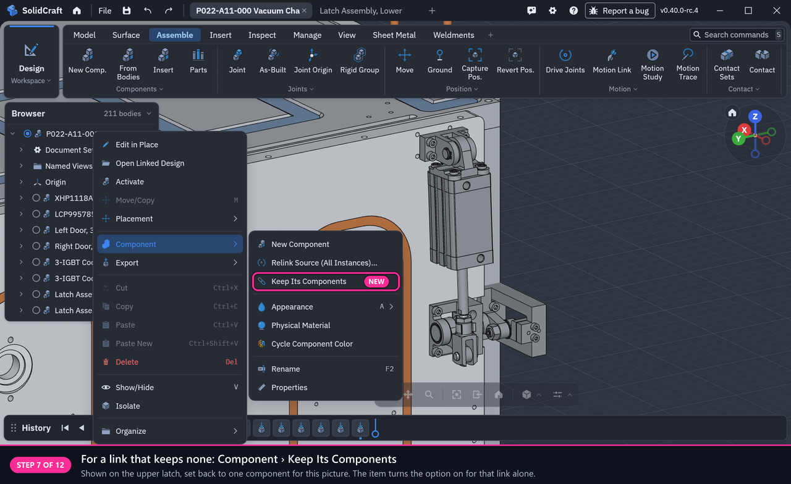

## 8. The occurrence's menu: Make Flexible

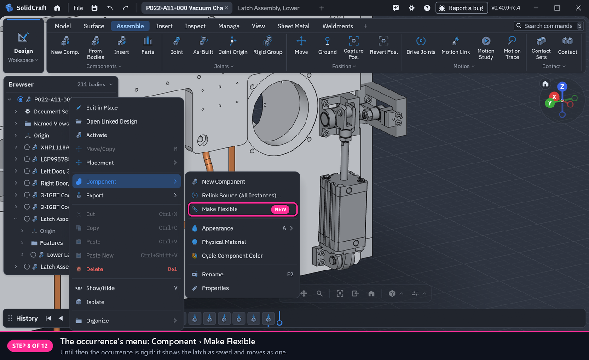

## 9. Flexible: the latch's joints are joints of this design

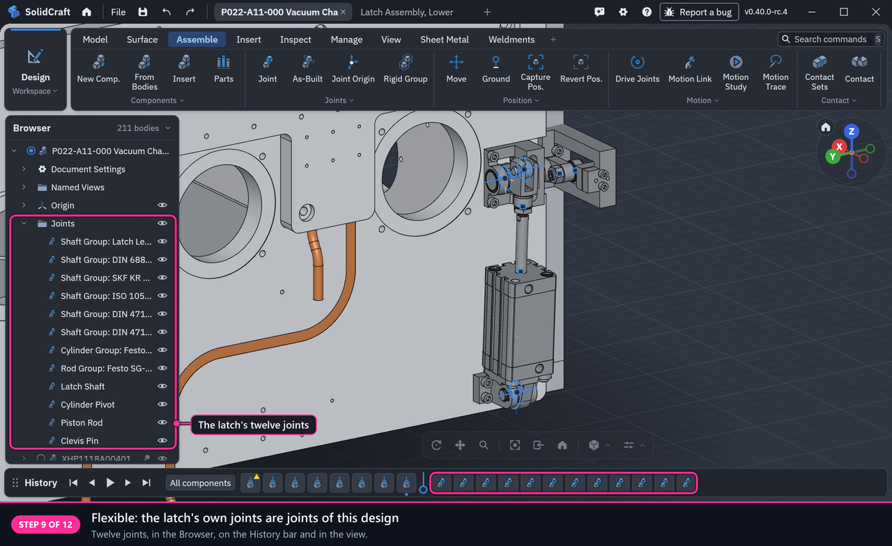

## 10. The same menu now offers Make Rigid

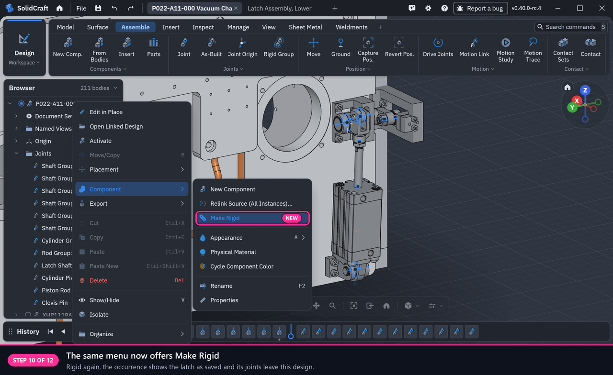

## 11. The result: the latch driven open inside the chamber

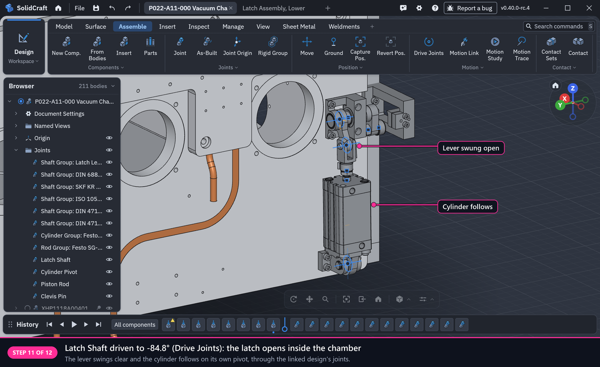

## 12. The result: one latch flexible and open, the other as saved

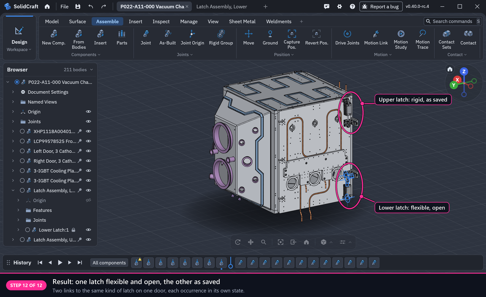

## Detail: the greyed preference says what it needs

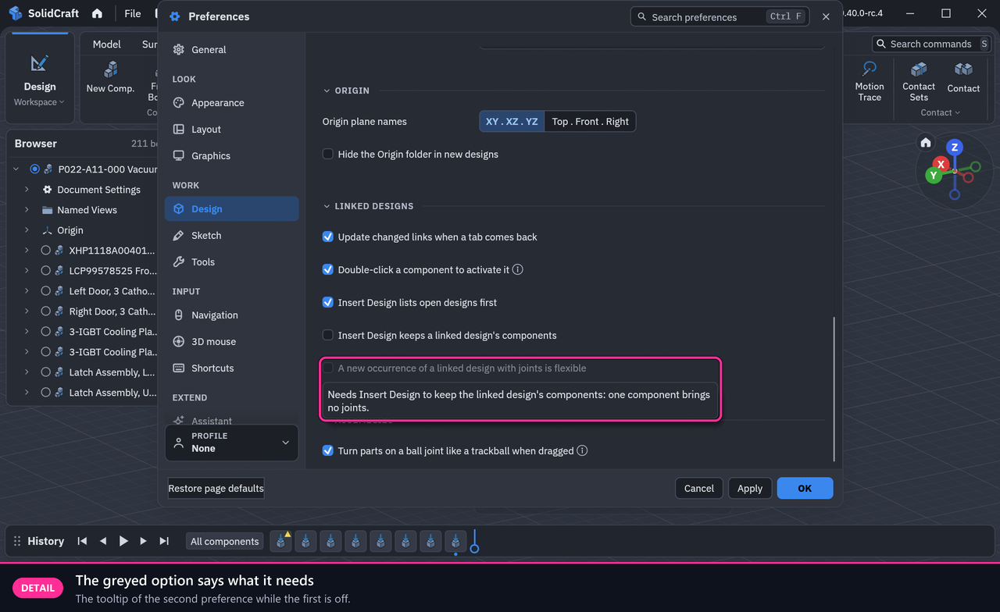

## What these show for the small window

- The two preferences each fit on one line of Preferences › Design › Linked designs (steps 2 and 3). The second is greyed until the first is on, and its tooltip says why (last picture).
- The new menu items sit in the existing Component submenu, one at a time: Keep Its Components, Make Flexible or Make Rigid (steps 7, 8 and 10). The menu and its submenu stay inside the window.
- The Browser shortens long names as it does for any component. A kept component has a lock (steps 5 and 6), and a flexible occurrence's joints are listed with the design's joints (step 9).

One thing that is not from this change: the warning mark on the first History item is the chamber body's own STEP import (three of its bodies come in as surfaces).
